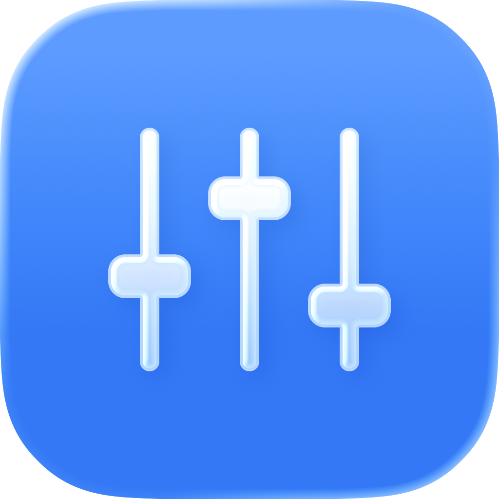

<p align="center">
  
</p>

<h1 align="center">Soundcheck</h1>

<p align="center">
  <b>The Sound menu your Mac should have had.</b><br>
  Every speaker, app and microphone on your Mac, from one speaker in the menu bar: a volume for each app,
  several speakers at once, AirPlay to HomePods in sync, and a microphone that mixes.<br>
  Free and open source, made for macOS 26 Tahoe.
</p>

<p align="center">
  <a href="https://github.com/myles-dean/Soundcheck/releases/latest/download/Soundcheck.dmg"><b>⬇︎ Download Soundcheck (DMG)</b></a>
  &nbsp;·&nbsp; <a href="#features">Features</a>
  &nbsp;·&nbsp; <a href="#what-makes-it-different">What makes it different</a>
  &nbsp;·&nbsp; <a href="#install">Install</a>
  &nbsp;·&nbsp; <a href="#faq">FAQ</a>
</p>

<p align="center">
  
  
  
  <a href="https://github.com/myles-dean/Soundcheck/releases/latest"></a>
</p>

---

**Soundcheck** replaces the Sound icon in your Mac's menu bar. Apple's Sound menu plays through one
speaker at a time, has one volume for everything, and leaves your microphone in System Settings.
Soundcheck puts all of it in one Liquid Glass panel that looks and moves like Control Center:

- **Speakers.** Play through as many speakers as you like at once, each at its own volume.
- **Apps.** A volume for every app that's making sound, with mute, boost and its own speakers.
- **AirPlay.** Stream to HomePods and other AirPlay speakers, in sync with your Mac's own speakers.
- **Mics.** One virtual microphone, *Soundcheck Mic*, that every app uses. Pick the real mic once, in
  Soundcheck, or mix several mics and apps into it.
- **The volume keys.** Your keyboard's volume keys move whichever group you pick (speakers, apps or
  mics), with an Apple-style volume pill.

Its speaker icon only appears in the menu bar while something is playing or a mic is listening, so
most of the time it isn't there at all.

## What makes it different

There are good sound apps for the Mac, but each covers one piece. Soundcheck puts the whole set
in one free app:

- **Everything in one place, for free.** The closest app is Rogue Amoeba's SoundSource ($49), which
  also has per-app volume, speaker groups and AirPlay. For a virtual mic that mixes mics and apps you'd
  add their Loopback ($99). Soundcheck does all of it, free and open source under the MIT license.
- **AirPlay that stays in sync.** Soundcheck has its own AirPlay 2 sender. It follows the HomePods'
  network clock (PTP) the way macOS does, so several AirPlay speakers and your Mac's own speakers play
  as one. From Control Center, macOS itself
  [can't play to several AirPlay speakers](https://support.apple.com/105068) (only the Music app can),
  and the free per-app volume apps, FineTune and Background Music, don't send to AirPlay at all.
- **A microphone you set once.** Soundcheck Mic is always your Mac's microphone while Soundcheck runs,
  so you switch mics in the menu bar and every app follows. No more digging through each app's audio
  settings, and you can mix in more mics and apps whenever you like.
- **Volumes that move together, sensibly.** Groups keep their balance: the main bar moves every
  speaker (or app, or mic) by the same amount, the volume keys can go past full until everything is at
  full, and nothing forgets its level when you unplug it. macOS's own Multi-Output Device plays through
  several speakers, but the volume keys and menu bar slider don't work with it.
- **Made for calls.** Quiet Apps in Calls lowers or mutes everything else while an app uses the mic,
  Mute Mics has its own shortcut, and you can see which apps are listening.
- **Feels like part of macOS.** A Liquid Glass panel that opens like Control Center's menus, a volume
  pill styled like Apple's, and a speaker icon that only shows up when there's something to control.
- **No driver for app volumes.** Per-app volume, extra speakers and AirPlay use macOS's own process
  taps. The only thing Soundcheck installs is Soundcheck Mic, and only when you ask for it.

### How it compares

| | Soundcheck | SoundSource 6 | FineTune | Background Music |
| --- | :---: | :---: | :---: | :---: |
| Price | **Free** | $49 | Free | Free |
| Open source | ✓ MIT | — | ✓ GPL-3.0 | ✓ GPL-2.0 |
| A volume for each app | ✓ | ✓ | ✓ | ✓ |
| Send an app to its own speakers | ✓ | ✓ | ✓ | — |
| Several speakers at once, each with its own volume | ✓ | ✓ | ✓ | — |
| AirPlay speakers, in sync with the Mac's speakers | ✓ | ✓ | — | — |
| Virtual mic that mixes mics and apps | ✓ | — ¹ | — | — |
| Volume keys with their own volume pill | ✓ | ✓ | ✓ | — |
| Lower or mute apps during calls | ✓ | — | — | — ² |
| Saved setups | ✓ | ✓ | — ³ | — |
| Installs a system audio add-on for app volumes | No | Yes | No | Yes |
| EQ and audio effects | — | ✓ | ✓ | — |

— means the app doesn't offer it, as far as its own site and docs say (checked November 2026).
¹ Rogue Amoeba sells this separately as Loopback ($99).
² Background Music can pause your music player when other audio plays.
³ FineTune has EQ presets and remembers settings per device.

Soundcheck doesn't have an EQ or audio effects yet. If that's what you're after, SoundSource,
FineTune and [eqMac](https://eqmac.app) all have one.

## Features

### The panel

Click the speaker in the menu bar. At the top, **Sound** has a three-part switch:
**Speakers | Apps | Mics**. Whichever you choose is what the main volume bar and your keyboard's
volume keys control.

The main bar always shows the loudest one in the group, and moving it moves everything in the group by
the same amount. With one speaker at half and two at zero, dragging the main bar to full gives full,
half and half. Turn the volume keys up past full and the quieter ones keep rising until everything is
at full. The gaps between them are remembered.

### Speakers

- **Several at once is the default.** Open the Speakers list. Click a speaker to play only through
  it, or click its circle to add it alongside the others: your MacBook's speakers, a display, USB
  speakers, headphones, AirPlay speakers, all at once.
- **Mix** gives every speaker its own volume bar. It opens by itself when your speakers are at
  different volumes. Close it and they all even out at the loudest one.
- **Displays and devices without a volume** (most HDMI and DisplayPort monitors) get a real volume
  anyway, and their volume keys work.
- **Switch to Headphones.** Plug in headphones and everything moves to them, with a pill to say so.
- **Every speaker remembers its volume**, across unplugging, restarting and relaunching.

### AirPlay

The **AirPlay** row in the Speakers list opens to the AirPlay speakers on your network, with their
icons and names, like Apple's own picker. Its icon shows how many are playing.

- **Soundcheck streams to them itself.** It's a full AirPlay 2 sender built into the app, so
  AirPlay speakers are just more speakers: pick several, mix them with the Mac's own speakers, give
  each its own volume.
- **In sync, automatically.** Soundcheck keeps time the way a Mac does: it follows the HomePods'
  own network clock (PTP), plays every AirPlay speaker on the same timeline, and holds your Mac's
  speakers back by exactly as long as AirPlay takes. There's no delay slider to fiddle with.
- **HomePods connect with no code.** An Apple TV shows a code on screen the first time; type it into
  the AirPlay list and it's remembered (in your Keychain).

### Apps

- **A volume for every app that's making sound.** The Apps list shows their icons stacked, with a
  "+3"-style count for the rest. Open it for a bar per app.
- **Click an app's icon to mute it.** If a muted app starts playing later, a pill tells you it's muted,
  once, so you're never left wondering why something's silent.
- **Boost Apps** lets a quiet app go up to 200%, past a tick at 100%, with a limiter so it doesn't
  crackle.
- **Split** sends an app to its own speakers: music on your desk speakers while a call stays on your
  headphones.
- **Pinned Apps** always have a bar, even when they're quiet.
- **Every app remembers its volume.** App bars move on their own, unless you pick **Apps** at the top,
  where the main bar and the volume keys move them all together.

### Mics and Soundcheck Mic

**Soundcheck Mic** is a virtual microphone that Soundcheck adds to your Mac. While Soundcheck is
running it's your Mac's microphone, and it carries whichever real mic you pick in Soundcheck. That
means Zoom, FaceTime, Discord, OBS and your browser never need their microphone setting changed again:
you change it once, in the menu bar, and every app follows.

- **Route** mixes into Soundcheck Mic. Tick as many mics as you like, each with its own level, and add
  apps too (each with its own level), so the people on your call hear your music, a soundboard or a
  game along with you.
- **Live level meters** run inside every mic slider, a lighter shade of the bar that follows how loud
  you are. They're sized to the slider, so a mic turned all the way down shows nothing.
- **A mic at zero is muted**, really muted, in the hardware and in the mix.
- **Mute Mics** has a keyboard shortcut you choose, and a pill shows **Mics Muted** or **Mics On**.
- **See who's listening.** An orange dot and the apps' icons show which apps are using the mic right
  now.
- When **Mics** is picked at the top, the main bar is your mic level, with its meter.

### Options

The **•••** menu in the panel:

| Option | What it does |
| --- | --- |
| Open at Login | Starts Soundcheck when you log in |
| Keep in Menu Bar | Shows the speaker icon all the time, not only while something plays or listens |
| Switch to Headphones | Moves all sound to headphones when they're plugged in (on by default) |
| Quiet Apps in Calls | While an app is using the mic, lowers every other app, or mutes them |
| Boost Apps | Lets app volumes go past 100%, up to 200% |
| Mute Mics | Mutes every mic, with a keyboard shortcut you set |
| Pinned Apps | Apps that always show in the Apps list, chosen from what's playing or with Finder |
| Saved Setups ↗ | Opens the Saved Setups window; your setups are listed below it with Apply buttons |
| Reset | Evens out the speakers, puts every app back to full and unmuted, and turns Split and Route off |
| Sound Settings… | Opens macOS's Sound settings |

### Saved Setups

A setup is a layout you can apply in one click: which speakers play and how loud, each app's volume,
mute and speakers, and what goes into Soundcheck Mic. Make one from how things are right now and
edit it in the Saved Setups window. *Work* might be headphones, Slack quiet and your USB mic; *Movie*
might be the TV's speakers plus the HomePods, everything else muted.

### The volume pill

With Soundcheck allowed to use the volume keys, pressing them shows Soundcheck's own pill instead of
Apple's, styled like it, for the group you're changing. Volume knobs on Windows-style keyboards work
too. The menu bar icon's waves fill with the volume, and it animates the way Apple's does when you
mute.

## Install

1. [Download Soundcheck.dmg](https://github.com/myles-dean/Soundcheck/releases/latest/download/Soundcheck.dmg),
   open it and drag **Soundcheck** to **Applications**.
2. Open Soundcheck. A short walkthrough covers the settings, the permissions, adding Soundcheck Mic
   and hiding Apple's Sound icon.
3. Hide Apple's Sound icon so there's only one: **System Settings › Menu Bar**, set **Sound** to
   **Don't Show**.

Or install it with [Homebrew](https://brew.sh):

```bash
brew tap myles-dean/tap
brew trust myles-dean/tap
brew install --cask soundcheck
```

Soundcheck needs **macOS 26 Tahoe** or later.

### Permissions

macOS asks before an app can do these, so Soundcheck asks for each one when you first need it (the
walkthrough lists them all):

| Permission | What it's for |
| --- | --- |
| Accessibility | Taking over the volume keys and showing Soundcheck's volume pill |
| System Audio Recording | App volumes, several speakers, AirPlay and routing apps into Soundcheck Mic |
| Microphone | Carrying your real mic into Soundcheck Mic |
| Local Network | Finding AirPlay speakers and streaming to them |

Adding **Soundcheck Mic** asks for your password once, because it installs a small audio driver in
`/Library/Audio/Plug-Ins/HAL`. Your sound pauses for a second while macOS loads it.

## FAQ

**Why does a recording icon appear next to Control Center?**
That's macOS's privacy indicator for "system audio recording". It shows whenever an app takes in
other apps' sound, which is how Soundcheck changes an app's volume, plays through several speakers,
streams to AirPlay and routes apps into Soundcheck Mic. Nothing is recorded or saved. Apple sets the
icon and its colour, and no app can hide it. When Soundcheck isn't changing anything (one speaker,
every app at full, no AirPlay or Route), it lets go and the icon goes away.

**Does Soundcheck record anything or send anything anywhere?**
No. Sound passes through it to your speakers and to Soundcheck Mic, and nothing is written to disk.
The only network traffic is to AirPlay speakers you pick.

**Which AirPlay speakers work?**
HomePods are tested and connect with no code. Apple TVs pair with the code they show on screen the
first time. Other AirPlay 2 speakers and TVs should work, but they're experimental for now. If one
won't connect, please [open an issue](https://github.com/myles-dean/Soundcheck/issues).

**What happens to my microphone if I quit Soundcheck?**
Your real mic becomes the Mac's microphone again, and every app gets its own sound back.

**How do I remove Soundcheck Mic?**
`brew uninstall --zap --cask soundcheck` removes it. Without Homebrew, quit Soundcheck and run:

```bash
sudo rm -rf /Library/Audio/Plug-Ins/HAL/SoundcheckMic.driver && sudo killall coreaudiod
```

**Why macOS 26 only?**
Soundcheck is built on Core Audio process taps and the Liquid Glass design that's new in
macOS 26 Tahoe.

## Build from source

You need Xcode 26 or later and [XcodeGen](https://github.com/yonaskolb/XcodeGen)
(`brew install xcodegen`).

```bash
./build.sh            # build into ./build
./build.sh install    # build, install to /Applications and launch
./build.sh release    # Developer ID build packaged as build/Soundcheck.dmg
```

How it fits together:

- `App/Audio`: the engine. Each app's sound is taken with a Core Audio process tap, set to its volume
  and played to its speakers through private aggregate devices; with AirPlay, one mixer feeds every
  speaker from the same timeline.
- `App/AirPlay`: the AirPlay 2 sender (discovery, HomeKit pairing, encryption, the RTP stream and PTP
  timing).
- `App/UI`: the menu bar panel, volume pill, walkthrough and Saved Setups window.
- `Driver`: Soundcheck Mic, a Core Audio driver (AudioServerPlugIn) with a visible microphone and a
  hidden output that Soundcheck feeds.

## Credits

The AirPlay sender is a Swift port of [pyatv](https://github.com/postlund/pyatv) by Pierre Ståhl,
with PTP timing from OwnTone's [libairptp](https://github.com/owntone/libairptp) and
[tuxplay](https://github.com/ksha23/tuxplay). Their licenses are in
[THIRD_PARTY_NOTICES.md](THIRD_PARTY_NOTICES.md).

## License

[MIT](LICENSE) © 2026 Myles Dean
